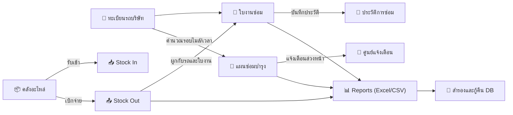

# 🚗 คู่มือการใช้งานระบบบริหารรถบริษัท คลังอะไหล่ และประวัติซ่อมบำรุง
### Garage Storage & Fleet Vehicle Maintenance Management System

---

## 1. การเริ่มต้นเปิดใช้งานระบบ (Windows Single-Machine)

ระบบถูกออกแบบมาให้ติดตั้งและเปิดใช้งานบนคอมพิวเตอร์เครื่องเดียวได้อย่างสะดวกรวดเร็ว โดยข้อมูลถูกบันทึกไว้ในดิสก์จริงที่ `./data/storage.db` ไม่สูญหายเมื่อปิดเบราว์เซอร์หรือรีสตาร์ตเครื่องคอมพิวเตอร์

### วิธีติดตั้งและเปิดใช้งาน (สำหรับช่าง / ผู้ใช้งานทั่วไป):
- **ติดตั้งครั้งแรก (ทำครั้งเดียว):** ดับเบิลคลิกไฟล์ **`👉_ติดตั้งระบบครั้งแรก_คลิกที่นี่.bat`**
  - ระบบจะติดตั้งโปรแกรม, เตรียมฐานข้อมูล, สร้างไอคอนทางลัด **`FleetManagement`** บนหน้าจอ Desktop ให้เอง และเปิดหน้าเว็บให้พร้อมใช้งานทันที
- **การเปิดใช้งานในแต่ละวัน:** 
  - ดับเบิลคลิกที่ไอคอน **`FleetManagement`** บนหน้าจอ Desktop ได้เลยทันที (หรือดับเบิลคลิกไฟล์ `start-app.bat` ในโฟลเดอร์)


---

## 2. สรุปความสามารถของระบบทั้ง 12 เมนูหลัก



### 1. แดชบอร์ดภาพรวม (Dashboard)
- การ์ดสรุป 10 ด้าน (รถทั้งหมด, รถพร้อมใช้, รถรอ/กำลังซ่อม, งานซ่อมค้าง, อะไหล่ใกล้หมด/หมดสต็อก, รถเกินกำหนดบำรุงรักษา)
- ตัวกรอง 5 ช่วงเวลา (7 วัน, 1 เดือน, 6 เดือน, 1 ปี, และกำหนดเอง)
- ตารางงานซ่อมปัจจุบัน, ตารางรถที่ต้องเข้าเช็กระยะ, อะไหล่ใกล้หมด และประวัติการเคลื่อนไหวสต็อกล่าสุด

### 2. ข้อมูลรถบริษัท (Fleet Vehicles)
- บันทึกและแก้ไขข้อมูลทะเบียนรถ, ยี่ห้อ, รุ่น, แผนก, ผู้รับผิดชอบ และเลขไมล์
- **ระบบลบข้อมูลรถ**: สามารถลบข้อมูลรถที่ไม่ใช้งานแล้วออกจากระบบได้ พร้อมการตรวจสอบความปลอดภัย (หากมีประวัติใบงานซ่อม ใบเบิก หรือแผนซ่อมบำรุงที่ผูกอยู่ ระบบจะแจ้งเตือนและระบุจำนวนรายการที่เกี่ยวข้องอย่างโปร่งใส)
- ระบบตรวจสอบทะเบียนรถซ้ำก่อนบันทึก
- หน้ารายละเอียดรถรายคัน: ประวัติการซ่อมทั้งหมด, รายการอะไหล่ที่เคยเบิกไปใช้กับรถคันนี้, แผนซ่อมบำรุง, ประวัติเลขไมล์ พร้อมปุ่มเข้าถึงและจัดการลบใบงาน/ใบเบิกได้โดยตรง
- **ระบบป้องกันเลขไมล์ลด**: หากกรอกเลขไมล์น้อยกว่าเดิม ระบบจะร้องขอการยืนยันและเหตุผล

### 3. คลังอะไหล่ (Parts Inventory)
- ทะเบียนพัสดุอะไหล่ แสดงยอดคงเหลือ, จุดสั่งซื้อขั้นต่ำ (Reorder Point), ราคาทุน และตำแหน่งจัดเก็บ
- ปรับฟอร์มให้กระชับ โดยนำช่อง "ผู้จำหน่ายหลัก" ออก เพื่อความคล่องตัวในการบันทึก
- **ระบบลบรายการอะไหล่**: สามารถลบรายการอะไหล่ที่ไม่ได้ใช้หรือบันทึกผิดพลาดออกจากคลังได้ พร้อมระบบตรวจสอบความปลอดภัย (หากมีประวัติการเคลื่อนไหวสต็อกหรือเคยเบิกจ่าย ระบบจะป้องกันการลบเพื่อรักษาความถูกต้องทางบัญชีสต็อก)
- ฟังก์ชัน **ตรวจนับและปรับยอดสต็อก (Stock Adjustment)** บันทึกผลต่าง (+/-) พร้อมเหตุผลและผู้ตรวจนับเป็นประวัติ

### 4. รับอะไหล่เข้า (Stock In)
- บันทึกรับเข้าหลายรายการในใบเดียว ดึงราคาทุนล่าสุดและคำนวณยอดเงินรวมอัตโนมัติ
- ปรับฟอร์มให้กระชับและสะดวก โดยนำช่อง "ผู้จำหน่าย / ร้านค้า" ออก คงเหลือข้อมูลวันที่รับเข้า, เลขที่ใบสั่งซื้อ (PO/ใบส่งของอ้างอิง), และผู้รับสินค้าเข้าคลัง
- ปรับเพิ่มสต็อกและบันทึกประวัติการรับเข้าแบบ Database Transaction

### 5. เบิกจ่ายและคืนอะไหล่ (Stock Out & Return)
- **การเบิก**: บังคับผูกกับทะเบียนรถและใบงานซ่อมทุกครั้ง ตัดสต็อกจริงและป้องกันสต็อกติดลบ
- **การคืน**: บันทึกคืนอะไหล่ที่ไม่ได้ใช้งาน อ้างอิงใบเบิกเดิม แยกสถานะอะไหล่สภาพสมบูรณ์ (เพิ่มกลับสต็อก) หรือชำรุด (ไม่เพิ่มกลับสต็อก) พร้อมลดค่าใช้จ่ายในใบงานซ่อมอัตโนมัติ
- **ระบบลบประวัติการเบิกอะไหล่**: ในแท็บ "ประวัติใบเบิก & บันทึกคืน" สามารถกดลบใบเบิกได้ โดยระบบจะ:
  1. นำจำนวนอะไหล่ที่ยังไม่ได้ส่งคืนกลับเข้าสต็อกคลังอะไหล่ให้อัตโนมัติ (Revert Stock)
  2. ปรับลดยอดต้นทุนค่าอะไหล่ในใบงานซ่อมที่เชื่อมโยงอยู่ลงตามมูลค่าที่ยกเลิก
  3. ล้างประวัติการเบิกและการคืนของใบเบิกนั้นออกจากระบบ

### 6. ใบงานซ่อม (Repair Orders)
- ออกใบสั่งซ่อมรันเลขที่อัตโนมัติ (`RO-2569-10-xxxx`)
- บันทึกอาการที่แจ้ง, ผลการตรวจสอบ, ช่างผู้รับผิดชอบ, ไมล์ขณะเข้าซ่อม
- **เชื่อมโยงอะไหล่จริง**: คิดค่าอะไหล่จากใบเบิกที่ยืนยันแล้วจริงในระบบ
- **ซิงค์สถานะรถอัตโนมัติ**: เมื่อเปิดงาน รถจะปรับเป็น "รอซ่อม/กำลังซ่อม" และเมื่อซ่อมเสร็จหรือส่งมอบรถ รถจะปรับกลับเป็น "พร้อมใช้งาน" ทันที
- **ระบบลบใบงานซ่อม**: สามารถลบใบงานซ่อมได้จากหน้ารายการใบงาน หรือหน้ารายละเอียดใบงาน โดยระบบจะปรับสถานะของรถกลับเป็น "พร้อมใช้งาน" อัตโนมัติหากรถกำลังอยู่ในสถานะซ่อม

### 7. ประวัติการซ่อม (Repair History)
- สืบค้นประวัติการซ่อมย้อนหลัง ค้นหาตามทะเบียนรถ ยี่ห้อ อาการ หรือช่าง
- สรุปภาพรวมค่าใช้จ่าย: ค่าแรงช่าง, ค่าอะไหล่, และค่าใช้จ่ายอื่น ๆ
- **ระบบลบประวัติการซ่อม**: มีปุ่มลบประวัติงานซ่อมพร้อมหน้าต่างยืนยันความปลอดภัยในตารางประวัติทันที

### 8. แผนซ่อมบำรุง (Preventive Maintenance)
- รองรับเงื่อนไข 3 รูปแบบ: ตามเวลา (เดือน), ตามระยะทาง (กม.), หรือตามทั้งสองอย่างถึงก่อน
- คำนวณสถานะ 4 สี: ปกติ (เขียว), ใกล้ครบกำหนด (เหลือง), ถึงกำหนด (ส้ม), เกินกำหนด (แดง)
- บันทึกผลการทำเสร็จแล้ว ระบบจะคำนวณรอบถัดไปให้อัตโนมัติ
- **ระบบแก้ไขแผนซ่อมบำรุง**: สามารถกดแก้ไขชื่อรายการ, รอบเดือน, รอบระยะทาง (กม.), วันที่/ไมล์ที่ทำล่าสุด, ระยะวัน/กิโลเมตรแจ้งเตือนล่วงหน้า และหมายเหตุ ได้ทันที พร้อมระบบคำนวณวันและเลขไมล์ครบกำหนดรอบถัดไปใหม่อัตโนมัติ
- **ระบบลบแผนซ่อมบำรุง**: สามารถลบแผนซ่อมบำรุงที่ไม่ต้องการได้ ทั้งจากหน้าแผนซ่อมบำรุงหลักและจากหน้ารายละเอียดรถรายคัน พร้อมหน้าต่างยืนยันความปลอดภัยและล้างประวัติการบันทึกของแผนนั้นออกอย่างสะอาด

### 9. การแจ้งเตือน (Notifications)
- ศูนย์รวมการแจ้งเตือนรถเกินกำหนดบำรุงรักษา, อะไหล่ใกล้หมดสต็อก, และงานซ่อมที่ค้างอยู่
- แสดงระดับความเร่งด่วน พร้อมระบบกดทำเครื่องหมายว่าอ่านแล้ว

### 10. รายงานและส่งออกข้อมูล (Reports)
- 8 รายงานธุรกิจหลัก (รถทั้งหมด, ค่าใช้จ่ายรายคัน, การใช้อะไหล่, สต็อกคงเหลือ, เคลื่อนไหวรับเข้า-เบิกจ่าย, อะไหล่ใกล้หมด, รถครบกำหนดบำรุงรักษา, งานซ่อมค้าง)
- ส่งออกไฟล์ **Excel (.xlsx)** และ **CSV** (พร้อมรองรับภาษาไทยใน Excel ทันทีโดยไม่เพี้ยน)

### 11. สำรองและกู้คืนข้อมูล (Backup & Restore)
- ปุ่ม **"สำรองข้อมูลทันที"** ในคลิกเดียว (บันทึกเป็นไฟล์ SQLite snapshot ที่โฟลเดอร์ `/backups`)
- แสดงวันเวลาและขนาดไฟล์สำรองล่าสุด
- ระบบกู้คืนข้อมูลพร้อมขั้นตอนตรวจสอบ SQLite Header 16 ไบต์ และทำ Safety Backup อัตโนมัติก่อนเขียนทับ

### 12. ตั้งค่าระบบ (Settings)
- ตั้งค่าชื่อบริษัท/หน่วยงาน, เบอร์ติดต่อ, และระยะวัน/กิโลเมตรเตือนซ่อมบำรุงล่วงหน้า
- **ระบบตรวจสอบเวอร์ชัน & อัปเดตจาก GitHub (In-App System Update)**:
  - ตรวจเช็คเวอร์ชันโค้ดระหว่างเครื่อง Local และ GitHub อัตโนมัติ พร้อมปุ่ม "ตรวจหาเวอร์ชันใหม่"
  - มีปุ่ม "อัปเดตระบบทันที" ดึงโค้ดล่าสุดจาก GitHub และอัปเดตระบบในเครื่อง Local โดย **ไม่กระทบกับไฟล์ฐานข้อมูล `data/storage.db`**
- **ระบบสำรองข้อมูลอัตโนมัติ (Auto Backup Settings)**:
  - สวิตช์ เปิด/ปิด การสำรองข้อมูลอัตโนมัติ
  - เลือกรอบระยะเวลาสำรองข้อมูลอัตโนมัติ: **ทุกๆ 3 วัน / ทุกๆ 5 วัน / ทุกๆ 7 วัน (ค่าแนะนำ)**
  - ระบบจะตรวจสอบรอบวันและสำรองไฟล์ Snapshot ลงโฟลเดอร์ `./backups/` อัตโนมัติเมื่อเปิดใช้งานโปรแกรม
- **จัดการหมวดหมู่อะไหล่ (Part Categories)**: เพิ่มและลบหมวดหมู่อะไหล่ได้อย่างอิสระ มีระบบป้องกันการลบหมวดหมู่ที่มีอะไหล่ใช้งานอยู่
- **จัดการหมวดหมู่ประเภทรถ (Vehicle Types)**: เพิ่มและลบประเภทรถยนต์ เช่น รถกระบะ, รถบรรทุก 6 ล้อ, รถตู้, รถเก๋ง มีระบบป้องกันการลบประเภทที่มีรถผูกอยู่เพื่อความปลอดภัยของฐานข้อมูล

---

## 3. การใช้งานในรูปแบบ Desktop Application (Electron) & Auto-Updater

ระบบรองรับการเปิดใช้งานและแพ็กเกจเป็น Windows Desktop App ด้วย **Electron** พร้อมฟังก์ชัน **Auto-Updater** ตรวจสอบเวอร์ชันใหม่จาก GitHub Releases อัตโนมัติ:

### คำสั่งสำหรับ Developer / ผู้ดูแลระบบ:
- **เปิดแอป Desktop ในโหมด Development:**
  ```bash
  npm run electron:dev
  ```
- **เปิดแอป Desktop ในโหมด Production (หน้าต่างแอป Electron เต็มรูปแบบ):**
  ```bash
  npm run electron:start
  ```
- **สร้างไฟล์ติดตั้ง Windows Setup (.exe) ผ่าน electron-builder:**
  ```bash
  npm run electron:dist
  ```
  *(ไฟล์ตัวติดตั้ง .exe สำหรับแจกจ่ายจะถูกสร้างไว้ที่โฟลเดอร์ `dist/` อัตโนมัติ)*

### การทำงานของ Auto-Updater ใน Electron:
- เมื่อผู้ใช้เปิดแอป Desktop ระบบของ Electron (`electron-updater`) จะตรวจสอบ GitHub Releases ล่าสุดของ `looknamx/storage` ในเบื้องหลัง
- เมื่อพบ Release ใหม่ จะดาวน์โหลดอัปเดตให้อัตโนมัติ และแสดงกล่องข้อความถามผู้ใช้ว่าต้องการรีสตาร์ตเพื่อติดตั้งทันทีหรือไม่
- บนแถบเมนูด้านบนของแอป มีเมนู **"ระบบ > ตรวจหาอัปเดต (Check for Updates)"** ให้ผู้ใช้กดตรวจสอบเองได้ตลอดเวลา


